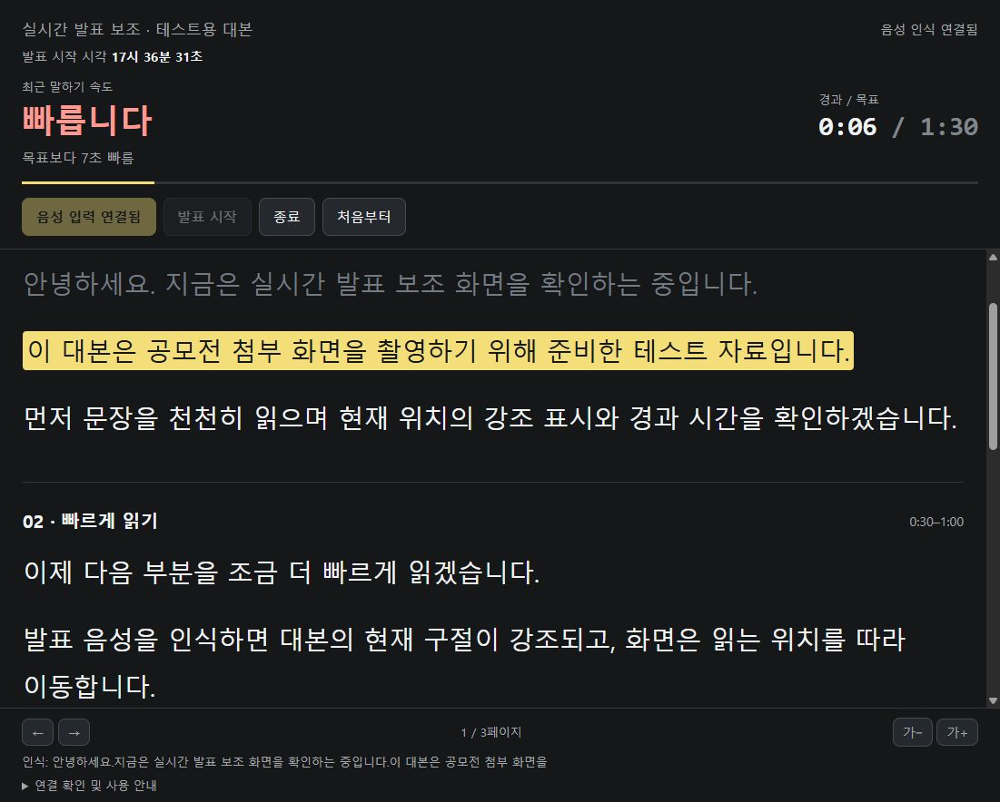
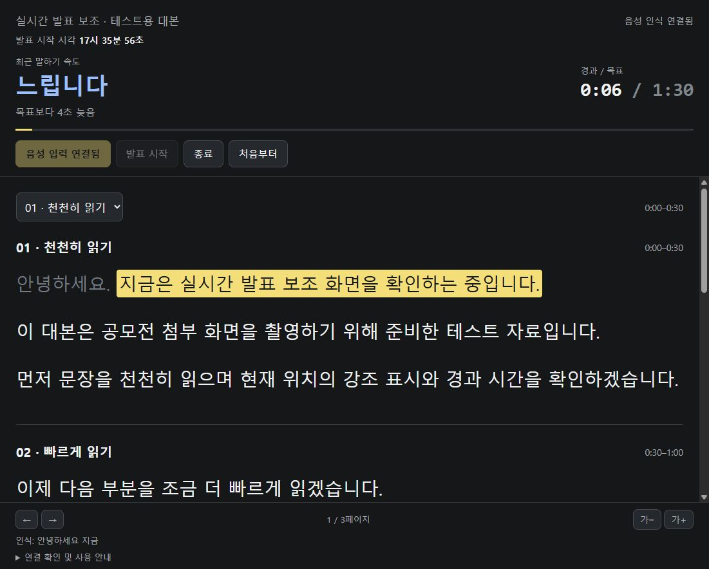

# 실시간 발표 보조 도구 · Presentation Pacer

발표 녹화 중 **지금 읽는 대본 위치와 말하기 속도**를 함께 확인하기 위해 AI와 협업해 제작한 로컬 웹 도구입니다.
발표 자료와 대본을 번갈아 보다가 위치를 놓치거나, 제한 시간에 맞춰 읽기 어려웠던 문제에서 출발했습니다.

> 제작: **2026년 10월 11일** · 테스트 화면 보완: **10월 14일** · GitHub 공개: **10월 30일**



위 화면은 2026년 10월 14일 Windows 한국어 합성 음성을 실제 음성 인식 연결에 전달한 테스트입니다.
사람이 직접 발표한 성능 측정 결과를 뜻하지 않습니다.

## 구현한 내용

- 음성 인식 결과와 준비한 대본을 비교해 현재 구절을 강조하고 자동 스크롤합니다.
- 최근 대본 진행량과 경과 시간을 비교해 `빠릅니다 / 적당합니다 / 느립니다`를 표시합니다.
- 전체 목표 시간 대비 빠르거나 늦은 정도와 발표 시작 시각을 표시합니다.
- 추적 위치가 어긋나면 대본 구절을 클릭해 직접 보정할 수 있습니다.
- 전체 대본을 한 화면에 표시하고 페이지 이동과 글자 크기 조절을 제공합니다.

속도는 단어 수나 발성 자체의 측정값이 아니라 **대본 진행량을 시간 계획과 비교한 추정**입니다.
슬라이드는 발표자가 직접 넘깁니다.

## 실행

화면과 로컬 서버에는 Node.js가 필요합니다. Windows PowerShell에서 다음을 실행합니다.

```powershell
git clone https://github.com/Jooooyun/presentation-pacer.git
cd presentation-pacer
npm start
```

브라우저에서 <http://127.0.0.1:43129>를 엽니다. 외부 npm 패키지를 설치할 필요는 없습니다.
Windows에서는 `START.cmd`를 실행해 서버와 브라우저를 열 수도 있습니다.

1. 기본 3페이지·90초 테스트 대본을 확인합니다.
2. 음성 추적을 사용하려면 `마이크 연결`을 누르고 마이크 접근을 허용합니다.
3. 음성 연결 상태를 확인한 뒤 `발표 시작`을 누릅니다.
4. 대본을 읽고, 종료할 때 `종료`를 누릅니다.

### 음성 연결 환경

보존된 브리지는 **당시 Windows npm 설치판 Codex CLI 0.155.1과 ChatGPT 로그인**을 사용한 실험 코드입니다.
`%APPDATA%/npm/node_modules/@openai/codex/` 아래 Windows x64 실행 파일을 찾으며,
Codex app-server의 실시간 WebRTC 음성 이벤트를 대본 추적에 연결합니다.
다른 설치 방식이나 최신 버전과의 호환성은 이 공개 작업에서 확인하지 않았습니다.
API 키를 입력하는 UI는 없으며, 계정의 음성 이용 한도는 적용될 수 있습니다.

화면 동작만 보려면 <http://127.0.0.1:43129/?test>를 열고 하단 `연결 확인 및 사용 안내`를 펼칩니다.
대본의 한 문장을 `화면 동작 점검용 문장`에 붙여 넣고 `점검 문장 적용`을 누르면
마이크나 원격 음성 연결 없이 대본 위치 추적을 살펴볼 수 있습니다.
개발 당시의 합성 음성 WAV는 공개본에 포함하지 않아 `합성 음성으로 실제 연결 점검` 버튼은 별도 원본 음원 없이 동작하지 않습니다.

## 대본과 코드

공개본에는 팀 발표 원문과 개인 자료 대신 **10월 14일에 제작한 테스트용 대본**을 포함했습니다.
`script-data.js`의 `window.PRESENTATION`에서 제목, 목표 초, 페이지별 시간과 문단을 확인할 수 있습니다.
기본 화면의 목표 시간 문구도 90초 테스트 화면에 맞춰져 있습니다.

| 파일 | 역할 |
| --- | --- |
| `index.html` | 대본과 시간·속도 표시 화면 |
| `app.js` | 음성 연결, 대본 강조, 스크롤, 진행 속도 추정 |
| `matcher.js` | 한국어·기술명 정규화와 오차를 허용하는 대본 위치 검색 |
| `bridge.cjs` | 로컬 HTTP/SSE 서버와 Codex app-server 연결 |
| `script-data.js` | 3페이지·90초 공개 테스트 대본 |

기술: JavaScript, HTML/CSS, Node.js, WebRTC, SSE, PowerShell.
문제 정의와 원하는 화면·동작을 정하고, AI와 구현·수정을 반복해 제작했습니다.

## 확인한 범위

- **10월 11일:** 한국어 합성 음성을 통한 인식 결과 수신과 대본 강조 이동을 관찰했습니다.
- **10월 14일:** 실제 마이크 연결과 시작 시각 표시를 확인했습니다. 느림·빠름 표시는 합성 음성으로 각각 관찰했습니다.
- 사람의 장시간 실제 발표에 대한 정확도나 지연 시간을 일반화할 수 있는 성능 평가는 하지 않았습니다.



원격 음성 인식을 사용하면 음성이 해당 서비스로 전송됩니다.
브리지에는 녹음 파일 저장 기능이 없으며, 사용자가 종료하거나 창을 닫으면 연결을 정리하도록 구현했습니다.
자세한 코드 근거와 관찰 범위는 [PRODUCT-TRUTH](memory/PRODUCT-TRUTH.md)에 정리했습니다.

## 제작 날짜와 Git 이력

이 도구는 Git 저장소 밖에서 제작했던 파일을 2026년 10월 30일 공개 저장소로 옮긴 것입니다.
첫 두 커밋은 보존된 10월 11일·14일 소스 스냅샷을 구분해 복원했으며,
작성일(`AuthorDate`)은 원본 파일의 최종 수정 시각을 반영했습니다.
커밋 기록일(`CommitDate`)과 저장소 생성·공개일은 실제 이관 날짜인 10월 30일입니다.
공개용 실행 파일, 소개 문서와 스크린샷 정리는 10월 30일 커밋에 포함합니다.
